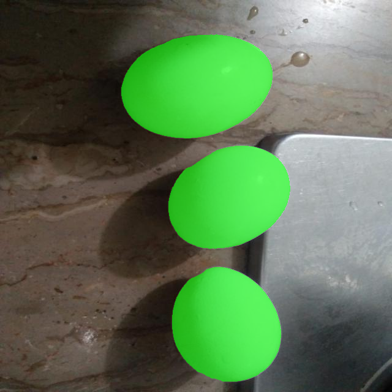
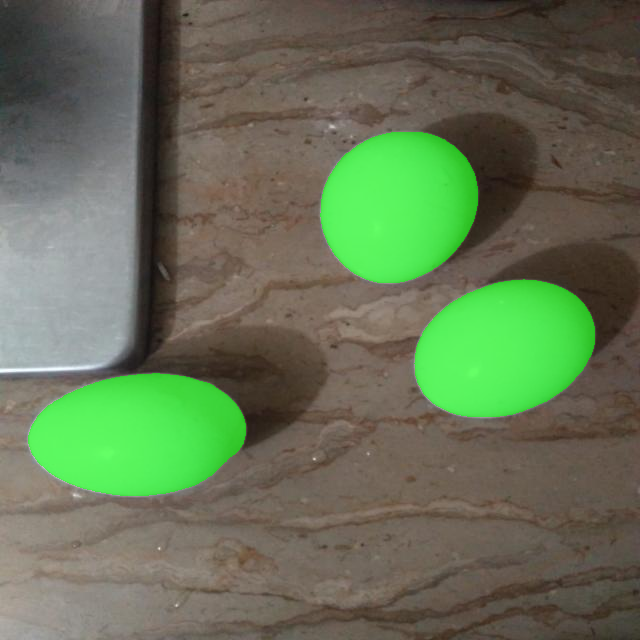
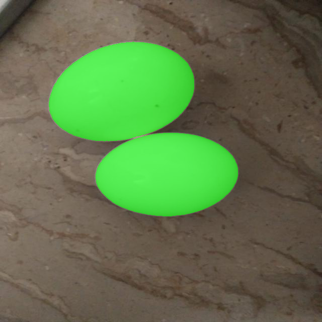
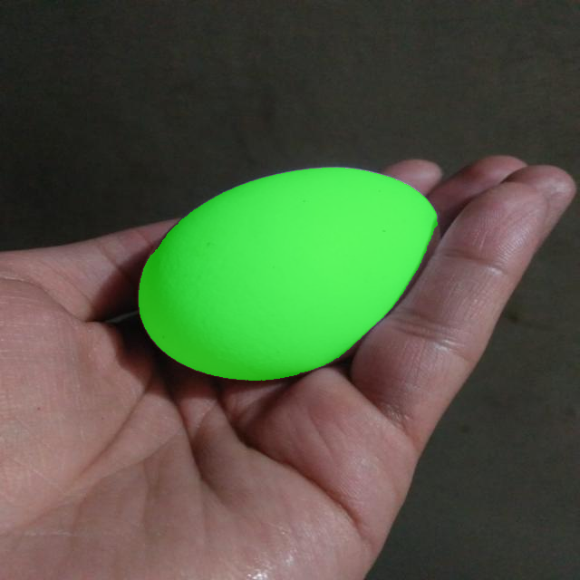

# Egg Segmentation using Segment Anything Model (SAM)


## 1. Project Overview


This project implements an egg segmentation pipeline using Meta AI's pretrained **Segment Anything Model (SAM), ViT-B**.


The objective is to identify and segment egg regions in images from the provided dataset without training a new segmentation model.


The implementation uses SAM's automatic mask generation, followed by geometric filtering and candidate selection. For two difficult images, interactive point prompts were used to obtain additional masks.


**Scope:** Task 1 – Pretrained segmentation using SAM.


## 2. Dataset


- **Dataset:** Egg – Version 1

- **Source:** [Roboflow Universe – Egg Dataset](https://universe.roboflow.com/fire-bf7qe/egg-vzhtr)

- **Provider:** A Roboflow user

- **License:** CC BY 4.0

- **Number of images:** 110

- **Image dimensions:** 640 × 640 pixels

- **Export date:** 23 May 2025


The dataset contains training, validation and test splits, along with two images in an unlabeled folder.


The original dataset attribution files are retained in `dataset/egg.v1i.folder/`.


The dataset uses folder-format annotations. It does not provide independent pixel-level segmentation ground-truth masks for quantitative evaluation.


## 3. Methodology


### 3.1 Model


The implementation uses the pretrained Segment Anything Model (SAM), ViT-B.


The model is used without task-specific fine-tuning.


### 3.2 Automatic Candidate Generation


SAM's automatic mask generation is applied to the dataset images.


The generated candidate masks and associated metadata are stored for subsequent analysis.


### 3.3 Candidate Analysis and Filtering


Candidate masks are evaluated using geometric and model-generated properties:


- Area ratio

- Bounding-box aspect ratio

- Bounding-box fill ratio

- Stability score


The Version 3 experimental selection parameters are:


| Parameter | Value |

|---|---:|

| Minimum area ratio | 0.025 |

| Maximum area ratio | 0.40 |

| Minimum aspect ratio | 0.60 |

| Maximum aspect ratio | 1.90 |

| Minimum stability score | 0.90 |

| Minimum bounding-box fill ratio | 0.68 |

| Duplicate overlap threshold | 0.70 |


Candidates are filtered using these conditions. The remaining candidates are ordered by stability score, and highly overlapping duplicate masks are removed using an overlap-based suppression step.


These are experimental heuristic thresholds selected through visual inspection and sensitivity testing. They are not learned classification parameters.


### 3.4 Point-Prompted Recovery


Some difficult images did not produce a suitable automatic mask.


Interactive positive and negative point prompts were therefore used with SAM's predictor for two images:


- **Image 10:** Candidate 3 was selected after reviewing the generated alternatives.

- **Image 117:** Candidate 2 was selected after reviewing the generated alternatives.


The resulting binary masks and overlays are stored separately under `results/manual_fallback_masks/`.


These masks represent the visible egg region where parts of the object are occluded.


Image 124 remained unresolved because no sufficiently reliable egg segmentation was identified.


## 4. Results


### 4.1 Full Dataset Automatic Selection


The Version 3 automatic pipeline processed all 110 dataset images.


| Dataset split | Images | Automatically selected masks | Images with no selected mask |

|---|---:|---:|---:|

| Train – labelled egg | 75 | 118 | 3 |

| Validation | 22 | 33 | 0 |

| Test | 11 | 13 | 0 |

| Train – unlabeled | 2 | 1 | 1 |

| **Total** | **110** | **165** | **4** |


The unlabeled images are kept separate from the labelled egg results. The selected candidate for one unlabeled image was visually assessed as a false positive and is not treated as a valid egg segmentation.


For the labelled egg images, the automatic pipeline selected 164 masks. Three training images initially had no selected automatic mask: Images 10, 117 and 124.


The separate point-prompted recovery stage produced additional masks for Images 10 and 117. Image 124 remains unresolved.


The automatic CSV summary records the automatic stage only; it has not been modified to include the manual fallback results.


### 4.2 Candidate Generation


A total of 2,329 automatic candidate masks were generated and saved with candidate metadata.


The candidate metadata and geometric analysis are included in the repository.


### 4.3 Representative Results


The following examples show selected automatic segmentation overlays.


#### Multiple eggs – Training image 103





#### Multiple eggs – Training image 105





#### Two eggs – Validation image 115





#### Egg held in a hand – Test image 1





### 4.4 Manual Fallback Results


The point-prompted masks and corresponding overlays for Images 10 and 117 are available in:


- `results/manual_fallback_masks/Image_10/`

- `results/manual_fallback_masks/Image_117/`


## 5. Validation and Limitations


A qualitative review and threshold-sensitivity study were performed on a 23-image sample, including representative train, validation and test images as well as difficult cases.


The review helped identify false-positive candidate masks, assess filtering thresholds and identify cases requiring point prompts.


The following limitations apply:


1. The dataset does not provide independent pixel-level ground-truth masks.

2. Therefore, IoU, Dice coefficient and pixel-level segmentation accuracy are not reported.

3. Automatic geometric filtering can reject valid masks or fail on heavily occluded objects.

4. Images 10 and 117 required interactive point prompts.

5. Image 124 remains unresolved.

6. The results are based on a pretrained zero-shot segmentation model and heuristic candidate selection, not a fine-tuned egg segmentation network.


The reported mask counts indicate the outputs generated by the pipeline; they should not be interpreted as measured segmentation accuracy.


## 6. Repository Structure


```text

submission/

│

├── README.md

├── .gitignore

├── requirements.txt

│

├── src/

│   ├── generate_sam_candidates.py

│   ├── analyse_egg_candidates.py

│   ├── process_all_sam_selections_v3.py

│   ├── point_prompt_review_10_positive_negative.py

│   └── point_prompt_review_117_positive_negative.py

│

├── checkpoints/

│   └── sam_vit_b_01ec64.pth  (download separately)

│

├── dataset/

│   └── egg.v1i.folder/

│       ├── train/

│       ├── valid/

│       ├── test/

│       ├── README.dataset.txt

│       └── README.roboflow.txt

│

└── results/

    ├── automatic_sam_candidates/

    ├── candidate_geometry_analysis.csv

    ├── final_sam_selection_v3_all_110/

    ├── manual_fallback_masks/

    │   ├── Image_10/

    │   └── Image_117/

    └── examples/

```


## 7. Installation and Execution


### 7.1 Requirements


- Python 3.11

- PyTorch

- Torchvision

- Segment Anything

- OpenCV

- NumPy

- Pandas

- Matplotlib


The dependency versions used in the development environment are recorded in `requirements.txt`.


### 7.2 Create a Virtual Environment


From the repository root:


```bash

python -m venv .venv

```


Activate it on Windows:


```bash

.venv\\Scripts\\activate

```


### 7.3 Install PyTorch and Torchvision


The development environment used CUDA 12.6 builds:


```bash

pip install torch==2.14.1 torchvision==0.29.1 --index-url https://download.pytorch.org/whl/cu126

```


For other hardware or CUDA configurations, install the compatible PyTorch and Torchvision builds using the official PyTorch installation instructions.


### 7.4 Install Other Dependencies


```bash

pip install -r requirements.txt

```


### 7.5 Download the SAM Checkpoint


The model checkpoint is not included in the repository because of its large file size.


Download the official SAM ViT-B checkpoint:


[Download sam_vit_b_01ec64.pth](https://dl.fbaipublicfiles.com/segment_anything/sam_vit_b_01ec64.pth)


Place the downloaded file at:


```text

checkpoints/sam_vit_b_01ec64.pth

```


### 7.6 Generate Automatic SAM Candidates


Run from the repository root:


```bash

python src/generate_sam_candidates.py

```


This generates candidate masks and metadata under:


```text

results/automatic_sam_candidates/

```


### 7.7 Analyse Candidate Geometry


```bash

python src/analyse_egg_candidates.py

```


The geometric analysis is saved as:


```text

results/candidate_geometry_analysis.csv

```


### 7.8 Run Version 3 Automatic Selection


```bash

python src/process_all_sam_selections_v3.py

```


This script uses the previously generated candidate masks and applies the Version 3 selection procedure.


The outputs are saved under:


```text

results/final_sam_selection_v3_all_110/

```


### 7.9 Interactive Point-Prompted Segmentation


For difficult cases, the point-prompt scripts can be run separately:


```bash

python src/point_prompt_review_10_positive_negative.py

```


```bash

python src/point_prompt_review_117_positive_negative.py

```


These scripts require interactive selection of positive and negative points in the image window.


## 8. AI Assistance Disclosure


AI tools were used to support code development, debugging, troubleshooting, visual review and documentation during this assignment.


The scripts were executed in the development environment, and the generated masks were reviewed. Interactive prompt locations and selected fallback candidates were reviewed as part of the workflow.


The use of AI assistance is disclosed here in accordance with the assignment guidance.


## 9. References


- [Segment Anything – Official GitHub Repository](https://github.com/facebookresearch/segment-anything)

- [Segment Anything Research Paper](https://arxiv.org/abs/2304.02643)

- [Roboflow Egg Dataset](https://universe.roboflow.com/fire-bf7qe/egg-vzhtr)

- [PyTorch Installation Guide](https://pytorch.org/get-started/locally/)


## 10. Acknowledgements


Thanks to the dataset provider for making the egg image dataset available through Roboflow Universe and to Meta AI Research for the pretrained Segment Anything Model.
